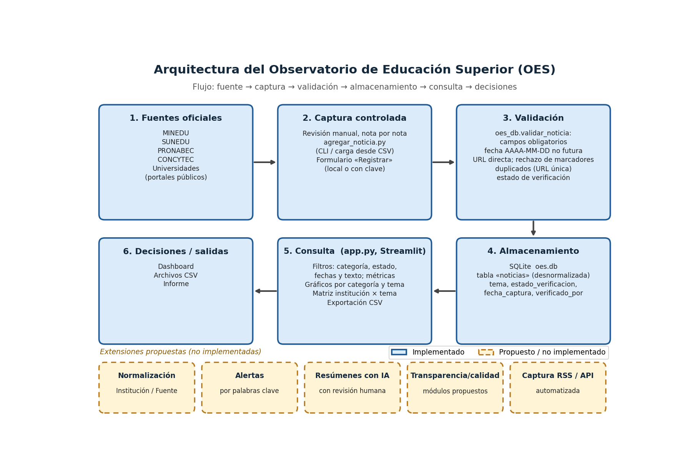
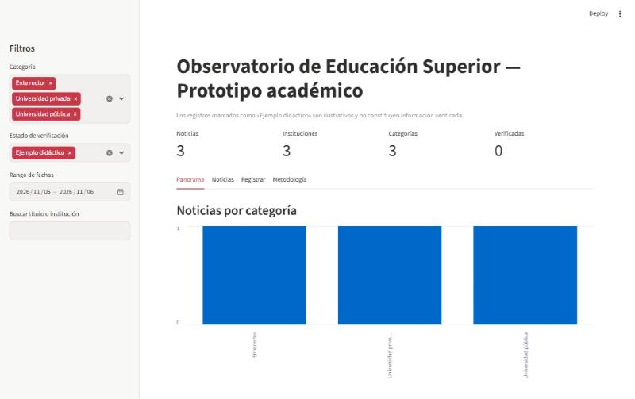
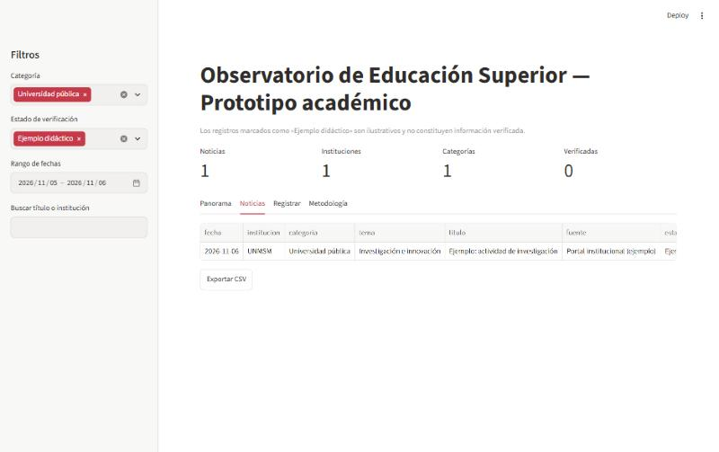
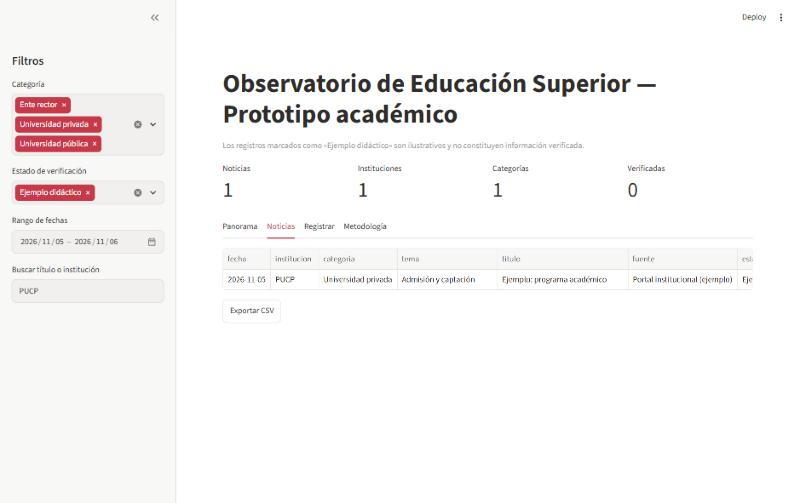
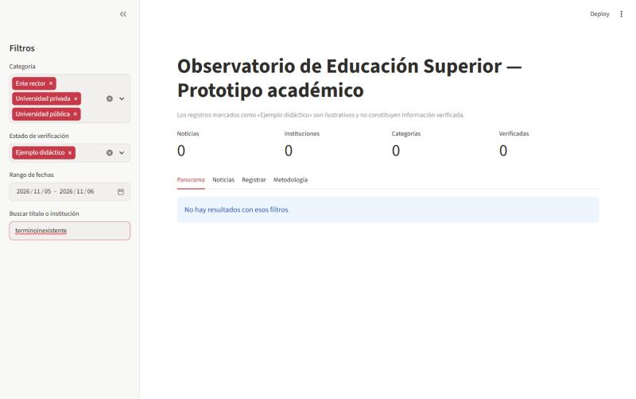
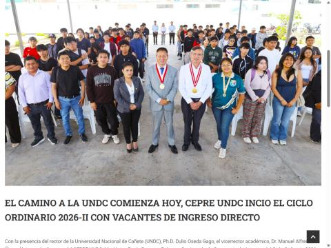
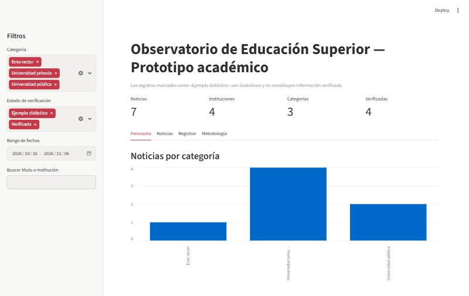
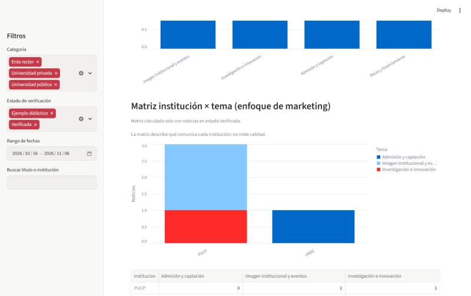

# Construcción de un Observatorio de Educación Superior (OES): El marketing en la educación

**Práctica Guiada N.° 08**
**Curso:** IA aplicada al Marketing Digital
**Integrantes:** [Completar nombres de los integrantes]
**Fecha:** 13/11/2026

---

## 1. Introducción y objetivo general

La comunicación de las instituciones de educación superior (convocatorias de admisión, becas, hitos de investigación, eventos, alianzas) es información pública dispersa en portales y comunicados. Un observatorio la reúne con fuente y fecha para poder compararla.

**Objetivo general.** Diseñar, implementar y validar un prototipo local de observatorio que registre, clasifique, consulte y visualice novedades de educación superior peruana con trazabilidad de fuentes.

**Relación con el marketing educativo.** El prototipo incorpora el campo *tema* de comunicación (admisión y captación, becas y financiamiento, imagen institucional y eventos, entre otros). La matriz institución × tema muestra qué comunica cada institución y con qué frecuencia. Este análisis es descriptivo del mensaje publicado: no mide la calidad académica de las instituciones ni el impacto de sus campañas.

## 2. Delimitación

El portal OES comercial declara tres plataformas (Tablero de Monitoreo Estratégico, OES Transparencia y OES Calidad), 115 fuentes y cuatro ciclos diarios de vigilancia (Observatorio de Educación Superior, 2026a). Estas cifras son afirmaciones del proveedor y no fueron verificadas por el grupo. El prototipo de esta práctica es una implementación educativa original, construida con Python, SQLite y Streamlit. No reproduce el código, la cobertura ni la automatización del portal. Opera con un conjunto reducido de registros cargados y revisados manualmente.

## 3. Arquitectura

Flujo general: **fuente → captura → validación → almacenamiento → consulta → decisiones**.

- **Fuente:** sitios oficiales (MINEDU, SUNEDU, PRONABEC, CONCYTEC, SINEACE) y portales de universidades.
- **Captura:** registro manual mediante el formulario *Registrar* de la aplicación, el script `agregar_noticia.py` (línea de comandos o carga desde CSV) y los registros DEMO creados por `preparar_datos.py`.
- **Validación:** `oes_db.validar_noticia` comprueba campos obligatorios, fecha AAAA-MM-DD no futura, URL directa sin marcadores, categoría, tema y estado permitidos, y exige verificador para el estado «Verificada». La base añade restricciones (`CHECK`, `UNIQUE`).
- **Almacenamiento:** una tabla `noticias` en SQLite, accedida solo desde `oes_db.py`.
- **Consulta:** filtros por categoría, estado, fechas y texto; exportación a CSV.
- **Decisiones:** panorama por categoría y por tema, y matriz institución × tema para orientar la lectura del mensaje institucional, siempre con revisión humana.

*Figura 1. Arquitectura del prototipo, distinguiendo lo implementado de lo propuesto.*

| Componente | Estado |
|---|---|
| Registro por formulario y por script, validación, tabla única SQLite, dashboard con filtros, panorama y exportación CSV | Implementado |
| Captura automática programada, múltiples plataformas, normalización en tres entidades, resumen asistido por IA con revisión, análisis prospectivo | Propuesto (no implementado) |

## 4. Modelo de datos

| Columna | Tipo | Descripción / restricción |
|---|---|---|
| id | INTEGER | Clave primaria autoincremental |
| titulo | TEXT NOT NULL | Titular de la nota |
| institucion | TEXT NOT NULL | Institución que publica |
| categoria | TEXT NOT NULL | Tipo de institución: Ente rector, Ente regulador, Universidad pública, Universidad privada |
| fuente | TEXT NOT NULL | Medio o portal de origen |
| fecha | TEXT NOT NULL | AAAA-MM-DD, con CHECK (fecha = date(fecha)) |
| url | TEXT NOT NULL UNIQUE | URL directa de la nota; evita duplicados |
| resumen | TEXT NOT NULL | Resumen de redacción propia |
| tema | TEXT NOT NULL (def. «Sin tema») | Tema de comunicación (marketing) |
| estado_verificacion | TEXT NOT NULL (def. «Ejemplo didáctico») | Ejemplo didáctico, Verificada o Pendiente |
| fecha_captura | TEXT NOT NULL (def. hoy) | Fecha en que se registró |
| verificado_por | TEXT | Persona o agente que verificó |

**Por qué es desnormalizada.** La guía propone una sola tabla porque simplifica la práctica: una consulta sin uniones, un esquema comprensible en una sesión y carga directa desde CSV. El costo es la repetición de institución, categoría y fuente en cada fila, lo que permite inconsistencias (por ejemplo, la misma institución escrita de dos formas).

**Propuesta de normalización (no implementada).** Tres entidades: *Institución* (id, nombre, categoría), *Fuente* (id, nombre, dominio, id_institución) y *Noticia* (id, título, fecha, url, resumen, tema, estado, fecha_captura, verificado_por, id_fuente). Esto elimina redundancia y permite integridad referencial, a cambio de uniones y de un proceso de carga más elaborado.

## 5. Requisitos y criterios de aceptación

| ID | Requisito (guía) | Verificación (guía) | Cómo lo cumple el prototipo | Resultado |
|---|---|---|---|---|
| RF01 | Registrar noticia con fuente, institución, fecha, título, URL y categoría | Registro aparece en tabla | Formulario Registrar y agregar_noticia.py (CLI y CSV), con validación e informe de duplicados (Figuras 6 y 7). | ✓ |
| RF02 | Filtrar por categoría y texto | Resultados cambian correctamente | Filtros de categoría, estado, fechas y búsqueda por título o institución (Figuras 3 a 5). | ✓ |
| RF03 | Calcular indicadores | Conteos coinciden con datos | Métricas, barras por categoría y tema, y matriz institución × tema (Figuras 2, 7 y 8). | ✓ |
| RF04 | Exportar resultados | Archivo CSV descargable | Botón «Exportar CSV» (oes_resultados.csv, UTF-8 con BOM) sobre el resultado filtrado (evidencia oes-06). | ✓ |
| RNF01 | Trazabilidad y ética | URL, fecha y fuente visibles | Cada noticia conserva fuente, URL directa única, fecha, fecha de captura, verificador y estado. | ✓ |
| RNF02 | Funcionamiento local | App inicia sin servicios de pago | SQLite local, variable OES_DB, requirements.txt con versiones fijas y Python 3.11. | ✓ |

## 6. Pruebas P1–P6

Las seis pruebas de la guía se ejecutaron sobre el prototipo. Además, la suite automática `pytest` (tests/test_oes.py) aprobó 13 de 13 pruebas.

| Prueba | Procedimiento (guía) | Resultado esperado (guía) | Resultado obtenido | Evidencia |
|---|---|---|---|---|
| P1 | Ejecutar carga dos veces | No se duplican las 3 URLs | ✓ Tras dos cargas la base tiene 3 filas y 3 URL distintas. | oes-02 (txt); Figura 2 (tablero 3/3/3) |
| P2 | Filtrar Universidad pública | Se muestra UNMSM (dato didáctico) | ✓ Solo aparece UNMSM. | Figura 3 (oes-03) |
| P3 | Buscar PUCP | Una fila en resultados | ✓ Una fila de PUCP. | Figura 4 (oes-04) |
| P4 | Buscar término inexistente | 0 noticias y aviso sin error | ✓ 0 noticias y aviso «No hay resultados con esos filtros», sin error. | Figura 5 (oes-05) |
| P5 | Exportar CSV | Archivo abre con encabezados y filas filtradas | ✓ CSV UTF-8 con encabezados y solo las filas filtradas. | oes-06 (csv) |
| P6 | Agregar una noticia real verificada | Aumenta contador y se conserva URL directa | ✓ De 3 a 7 noticias, 4 verificadas, URL directa conservada; una segunda carga las marca como duplicadas. | oes-07 (txt); Figuras 6 y 7 |

*Figura 2. Tablero inicial con 3 noticias, 3 instituciones y 3 categorías (registros DEMO) — P1.*

*Figura 3. Filtro «Universidad pública»: solo se muestra UNMSM — P2.*

*Figura 4. Búsqueda «PUCP»: una fila en resultados — P3.*

*Figura 5. Término inexistente: 0 noticias y aviso, sin error — P4.*

*Figura 6. Nota original de la UNDC abierta desde la URL directa guardada, usada para contrastar titular y fecha — P6.*

*Figura 7. Tablero final con 7 noticias (3 DEMO y 4 reales verificadas) — P6.*

## 7. Noticias reales cargadas

Para P6 se cargaron cuatro noticias reales con `agregar_noticia.py` desde `datos/noticias_univ.csv`. Cada una fue verificada por agentes de IA abriendo la URL directa y comprobando titular y fecha; por eso el verificador figura como agente de IA y **requieren confirmación del grupo**.

| Institución | Fecha | Tema | Asunto |
|---|---|---|---|
| UNDC | 2026-10-23 | Admisión y captación | Inicio del ciclo ordinario CEPRE 2026-II |
| PUCP | 2026-10-16 | Imagen institucional y eventos | Aula Magna 2026 |
| PUCP | 2026-10-30 | Investigación e innovación | Vivienda contra heladas con la Universidad Nacional de Juliaca |
| PUCP | 2026-11-06 | Imagen institucional y eventos | Doctorado honoris causa a Mircea Cărtărescu |

**Limitación.** Los portales gob.pe (MINEDU, SUNEDU, PRONABEC, CONCYTEC) bloquearon el acceso automatizado (HTTP 418, «Acceso restringido»). No se eludió el bloqueo; por ello no hay noticias reales de entes rectores o reguladores. Queda como tarea del grupo registrarlas a mano con `agregar_noticia.py`.

### Lectura de la matriz institución × tema

*Figura 8. Matriz institución × tema con las noticias cargadas.*

La PUCP concentra su comunicación en imagen institucional y eventos, mientras que la UNDC comunica admisión (captación). Esto es coherente con una lectura de marketing educativo, pero cuatro noticias reales no permiten generalizar: es una observación descriptiva sobre una muestra mínima y no aleatoria.

## 8. Respuestas a las preguntas de discusión

**(a) Diferencia entre un portal de noticias y un observatorio con análisis prospectivo.** Un portal agrega y ordena publicaciones cronológicamente; su valor es el acceso. Un observatorio añade criterios de selección explícitos, clasificación estable, series comparables en el tiempo y metodología documentada, de modo que se puedan identificar patrones. El análisis prospectivo va más allá: usa esas series para plantear escenarios y tendencias (por ejemplo, cambios regulatorios o de oferta de becas) y declara sus supuestos e incertidumbre. Este prototipo es un observatorio descriptivo; no hace prospectiva.

**(b) Riesgos de una noticia sin fecha o sin URL directa.** Sin fecha no se puede ordenar, filtrar por periodo ni saber si la información sigue vigente (una convocatoria cerrada puede parecer abierta). Sin URL directa no se puede auditar el origen, otra persona no puede reproducir la verificación, un enlace a la portada cambia con el tiempo y se pierde la deduplicación por URL. Por eso el prototipo rechaza ambos casos.

**(c) Por qué un conteo de noticias no demuestra calidad universitaria.** El número de noticias refleja el volumen de comunicación, que depende del tamaño del área de prensa, la estrategia de marketing y la presencia digital, no de la calidad de la enseñanza o la investigación. Además, la muestra depende de las fuentes elegidas (sesgo de selección) y no distingue entre noticia sustantiva y publicidad. La calidad requiere indicadores validados: licenciamiento, acreditación, producción científica y empleabilidad, entre otros.

**(d) Indicadores para estudiar ejecución presupuestal y regulación.** Para ejecución presupuestal: PIM (presupuesto institucional modificado), devengado y porcentaje de avance respecto al PIM, por institución y año, de Consulta Amigable del MEF. Para regulación y calidad: estado de licenciamiento institucional y de programas (SUNEDU), acreditación de programas (SINEACE) y producción científica de docentes registrados (RENACYT, CONCYTEC). Son datos estructurados con fuente oficial y periodicidad propia; no se obtienen de noticias, por lo que requerirían nuevas entidades en el modelo y otra forma de carga.

**(e) Cómo verificar un resumen generado con IA.** (1) Abrir la URL directa y leer la nota original. (2) Comparar cada afirmación del resumen (cifras, nombres, fechas, plazos) con el texto fuente. (3) Comprobar que fecha y titular coinciden con la publicación. (4) Descartar frases ausentes en la fuente (alucinaciones) o que cambien el sentido. (5) Reescribir con palabras propias lo dudoso. (6) Registrar quién verificó y marcar «Verificada» solo tras esta revisión humana; mientras tanto, «Pendiente».

## 9. Análisis crítico y ética

- **Fuentes oficiales y revisión manual.** Se priorizan sitios institucionales; cada registro se contrasta con la nota original.
- **robots.txt y términos de uso.** Antes de capturar automáticamente de un sitio se debe revisar su robots.txt y sus condiciones. El prototipo no implementa extracción automática. Cuando los portales gob.pe rechazaron el acceso automatizado (HTTP 418), no se intentó eludir el bloqueo.
- **No extracción masiva.** Se registran pocas notas, con título, fecha, URL y resumen propio; no se copian textos completos ni se sobrecargan los servidores.
- **Registros DEMO marcados.** Los 3 registros de la guía llevan el estado «Ejemplo didáctico» y la aplicación advierte que no son noticias verificadas.
- **Verificación por IA.** Los registros verificados por agentes de IA requieren confirmación humana del grupo antes de considerarse definitivos.
- **Límites del prototipo.** Muestra pequeña y no aleatoria; una sola tabla; clasificación temática manual y subjetiva; sin actualización automática; sin medición de calidad ni de impacto; sin análisis prospectivo.
- **Datos personales.** No se recolectan datos personales; solo información institucional publicada. El campo verificado_por identifica a quien revisó, por lo que conviene usar un nombre de grupo o iniciales acordadas.
## 10. Metodología de trabajo

El prototipo se construyó con un equipo de agentes de IA, sin subagentes anidados, con intervenciones de máximo ocho minutos cada una y coordinados mediante archivos de contrato y de entrega. El código, las pruebas y las evidencias se generaron así y deben ser revisados por el grupo, que responde por el contenido final.

## 11. Anexo — Observaciones y correcciones a la guía

| N.° | Problema detectado | Corrección aplicada |
|---|---|---|
| 1 | El subtítulo «El marketing en la educación» no tenía desarrollo. | Se agregó el campo tema y la matriz institución × tema. |
| 2 | La Figura 1 mostraba Instituciones/Fuentes/Noticias, pero se implementa una sola tabla. | Nuevo diagrama que distingue lo implementado de lo propuesto. |
| 3 | «Categoría» contiene el tipo de institución. | Se mantiene por compatibilidad con P2 y se añade tema como clasificación temática. |
| 4 | RF01 «Registrar noticia» no tenía interfaz. | Formulario Registrar y script agregar_noticia.py. |
| 5 | El Paso 7 usaba la ruta relativa oes.db, que crea una base vacía si se ejecuta desde otra carpeta. | Ruta absoluta y variable de entorno OES_DB. |
| 6 | El marcador https://URL-DIRECTA-DE-LA-NOTA podía insertarse por error y INSERT OR IGNORE ocultaba duplicados. | Validación que rechaza marcadores e informa duplicados. |
| 7 | use_container_width está obsoleto en Streamlit reciente. | Se usa width="stretch". |
| 8 | La fecha sin validar (texto libre) rompe el orden. | CHECK en SQLite y validación AAAA-MM-DD. |
| 9 | En PowerShell la activación del entorno puede bloquearse; el comando python del equipo era 3.8. | Nota Set-ExecutionPolicy -Scope CurrentUser RemoteSigned; se usó py -3.11. |
| 10 | Versiones sin fijar. | requirements.txt con versiones fijas. |
| 11 | Trazabilidad básica sin fecha de captura ni verificador. | Campos fecha_captura, verificado_por y estado_verificacion. |
| 12 | P6 no era reproducible entre grupos. | Se guarda la URL directa y la captura de la nota original. |

## 12. Conclusiones

- El prototipo cumple el objetivo de registrar, clasificar, consultar y visualizar novedades con trazabilidad de fuente, fecha, captura y verificación: las seis pruebas P1–P6 resultaron satisfactorias y la suite automática aprobó 13 de 13 pruebas.
- La validación en la entrada (fecha, URL directa, marcadores, duplicados) y las restricciones de la base evitaron los errores frecuentes de la guía original; en P1 y P6 las cargas repetidas no generaron duplicados y fueron informadas como tales.
- El campo tema y la matriz institución × tema permiten una lectura de marketing educativo: la PUCP concentra imagen institucional y eventos y la UNDC comunica admisión. Con solo cuatro noticias reales no se puede generalizar, y la matriz describe el mensaje, no la calidad ni el impacto.
- La verificación humana sigue siendo indispensable: las 4 noticias reales fueron verificadas por agentes de IA y quedan pendientes de confirmación del grupo. No hay noticias reales de entes (MINEDU, SUNEDU, PRONABEC, CONCYTEC) porque gob.pe bloqueó el acceso automatizado.
- Como mejora futura se propone normalizar el modelo en Institución, Fuente y Noticia, incorporar indicadores oficiales (PIM/devengado, licenciamiento, acreditación, RENACYT) y evaluar capturas automatizadas respetando robots.txt y los términos de uso.
## 13. Referencias

Consejo Nacional de Ciencia, Tecnología e Innovación Tecnológica. (s. f.). *Página institucional*. Gobierno del Perú. https://www.gob.pe/concytec

Ministerio de Educación. (s. f.). *Página institucional*. Gobierno del Perú. https://www.gob.pe/minedu

Observatorio de Educación Superior. (2026a). *Portal institucional*. Recuperado el 12 de noviembre de 2026, de https://observatorio.com.pe/

Observatorio de Educación Superior. (2026b). *Reporte de monitoreo con corte al 7 de noviembre de 2026* [Documento PDF proporcionado por la docente para análisis académico].

Programa Nacional de Becas y Crédito Educativo. (s. f.). *Página institucional*. Gobierno del Perú. https://www.gob.pe/pronabec

Python Software Foundation. (2026). *sqlite3 — DB-API 2.0 interface for SQLite databases* (Python 3.11). https://docs.python.org/3.11/library/sqlite3.html

Streamlit Inc. (s. f.). *Streamlit documentation*. https://docs.streamlit.io/

Superintendencia Nacional de Educación Superior Universitaria. (s. f.). *Página institucional*. Gobierno del Perú. https://www.gob.pe/sunedu

